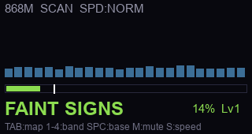
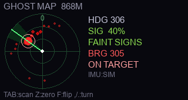

# Ghost Hunter

A CardputerZero game that turns the M5Stack Cap CC1101 and the onboard IMU into a two-screen ghost radar.

SCAN shows a live band spectrum and a smoothed threat level. GHOST MAP records how strong the signal was at each heading while you turn, and marks the strongest spot in red.

The CC1101 antenna is not directional. The bearing is whatever you swept, and remotes, sensors, and appliance noise show up too. It is a game, not a direction finder.




## Play

| Key | Action |
| --- | --- |
| Tab | Switch between SCAN and GHOST MAP |
| 1–4 | Band: 315 / 433 / 868 / 915 MHz |
| Space | Reset the baseline |
| M | Mute |
| S | Level speed: slow, normal, fast |
| Z | Zero the heading, clear the map, and recalibrate the gyro. Hold still for 1 second |
| F | Flip the rotation direction |
| `,` `.` or arrows | Turn by hand when the IMU is missing |
| Q or Esc | Quit |

If the Cap cannot be opened, the error stays on screen. **S** continues in simulation. **Q** quits.

From a shell on the device, in `ghost-hunter-v2/`:

```bash
python3 ghost_hunter_v2.py
python3 ghost_hunter_v2.py --sim
```

The store package starts the same game from APPLaunch as user `pi`. It does not need root. Heading comes from the kernel IIO driver. If that driver is missing, turn with the keys above.

## Package

Dependencies, installed by the `.deb`: `python3-pygame`, `python3-spidev`, `alsa-utils`, `fonts-dejavu-core`.

Build the package from a machine with `dpkg-deb`, using [AppBuilder](https://github.com/CardputerZero/AppBuilder)'s pack script:

```bash
/path/to/AppBuilder/scripts/pack-deb.sh ghost-hunter-v2 --output-dir build
```

That writes `build/ghost-hunter_2.1.0-1_arm64.deb`. Store listing fields live in `ghost-hunter-v2/app-builder.json`.

New 320×170 screenshots:

```bash
python3 ghost_hunter_v2.py --sim --size 320x170 --shot screenshots
```

## License

MIT. Copyright (c) 2026 Haoran Yan.
